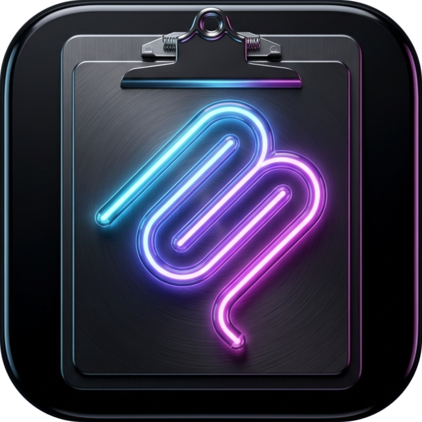
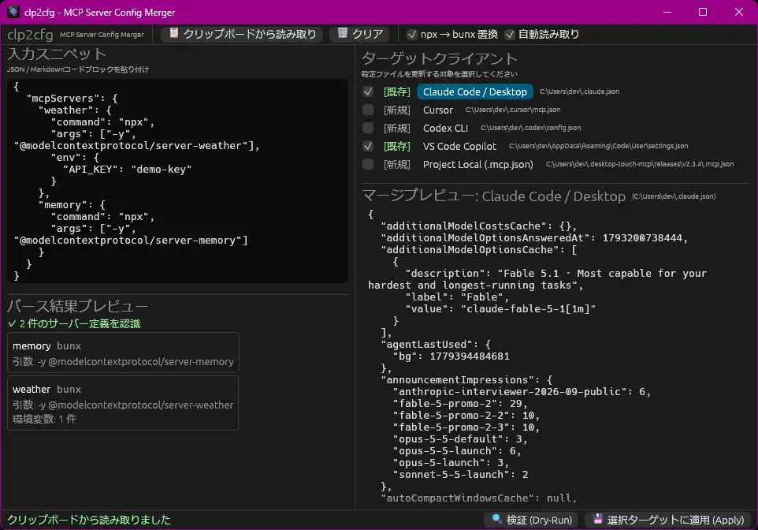

<div align="center">
  
  <h1>clp2cfg</h1>
  <p><strong>Clipboard to Config</strong> - MCP サーバー設定マネージャー</p>

  <p>
    <a href="https://github.com/scottlz0310/clp2cfg/actions/workflows/ci.yml"></a>
    <a href="https://codecov.io/gh/scottlz0310/clp2cfg"></a>
    <a href="https://github.com/scottlz0310/clp2cfg/releases"></a>
    <a href="https://github.com/scottlz0310/scoop-bucket"></a>
    <a href="#ライセンス"></a>
  </p>

  <p>
    
  </p>
</div>

Web サイトやドキュメントからコピーした任意の MCP (Model Context Protocol) サーバー設定 JSON スニペットを自動解釈（正規化パース）し、ローカル環境の各 AI クライアントの設定ファイルへ安全に差分マージ（Upsert）する軽量デスクトップ GUI ツールです。

## 主な特徴

- **多様なスニペットの自動解釈**: 完全な設定 JSON、サーバー定義のマップ、単一サーバー定義、JSONC（コメント・末尾カンマ）、Markdown 内のコードブロックを自動判定して正規化
- **対象クライアント設定の自動検出と AST マージ**:
  - Claude Code / Claude Desktop (`~/.claude.json`)
  - Cursor (`~/.cursor/mcp.json`)
  - VS Code Copilot (`settings.json`)
  - プロジェクト単位設定 (`.mcp.json`)
  - Windsurf (`~/.codeium/windsurf/mcp_config.json`)
  - Cline / Roo Code (VS Code `globalStorage` 内の MCP 設定)
  - Zed (`settings.json` の `context_servers`。JSONC のコメントは書き換え時に失われますが `.bak` に原本が残ります)
- **公式 CLI への委譲**: Claude Code / Codex / GitHub Copilot / Antigravity の各 CLI は、設定ファイルを直接編集せず `<cli> mcp add` をサブプロセス実行して登録（同名サーバーを上書きできない Claude Code / Copilot のみ事前に `mcp remove`）。実行予定コマンドはプレビュー欄で確認でき、Dry-Run では実行されません
- **既存設定の温存**: 未知のフィールドや既存ツール設定を破壊せず、MCP 設定のみを安全に注入
- **安全なアトミック書き込み**: 設定反映前に `.bak` バックアップを作成し、一時ファイルからのアトミック置換を実施
- **直前の適用の取り消し**: 「↩ 直前の適用を取り消す」で、直前の適用で書き込んだファイルを元に戻します（既存ファイルは `.bak` から復元、新規作成したファイルは削除）。適用後に内容が変わっているファイルは取り消さず、CLI 委譲ターゲットは対象外です
- **コマンドフィルタ**: `npx` → `bunx`、`pipx run` → `uvx` への自動最適化トグル対応
- **高速・軽量**: Rust + `eframe` (`egui`) による単一バイナリ動作

## インストール・入手方法

### 1. パッケージマネージャー（推奨）

Windows ではパッケージマネージャー経由でインストールすることで、環境変数 PATH の自動設定や、ブラウザダウンロード特有の **SmartScreen 警告（Mark-of-the-Web）を完全に回避** できます。

#### Scoop

個人バケットより即座にインストール・利用可能です：

```powershell
# バケットを追加してインストール
scoop bucket add scottlz0310 https://github.com/scottlz0310/scoop-bucket
scoop install clp2cfg
```

#### winget (Windows Package Manager)

現在 Microsoft 公式リポジトリへ登録申請中です（[microsoft/winget-pkgs#464302](https://github.com/microsoft/winget-pkgs/pull/464302)）。審査・自動パイプライン完了後に以下のコマンドで利用可能になります：

```powershell
winget install scottlz0310.clp2cfg
```

> [!NOTE]
> winget の審査・マージ完了までの間は、Scoop または以下のソースコードビルド / ポータブル ZIP をご利用ください。

### 2. ソースコードからビルド（SmartScreen 警告なし）

Rust (Cargo) 開発環境がある場合、ローカルでビルド・インストールすることで改ざんの心配なく安全に利用できます。ローカルでコンパイルされたバイナリには Mark-of-the-Web (Zone.Identifier) が付与されないため、**SmartScreen 警告は一切発生しません**。

```powershell
# 1 コマンドで GitHub から直接インストール
cargo install --git https://github.com/scottlz0310/clp2cfg

# またはソースコードをクローンしてビルド
git clone https://github.com/scottlz0310/clp2cfg.git
cd clp2cfg
cargo build --release
# target/release/clp2cfg.exe が生成されます
```

### 3. ポータブル ZIP のダウンロード（単体実行）

[GitHub Releases](https://github.com/scottlz0310/clp2cfg/releases) から最新の ZIP アーカイブ（Windows 用: `clp2cfg-x86_64-pc-windows-msvc.zip`、Linux 用: `clp2cfg-x86_64-unknown-linux-gnu.zip`）をダウンロードし、任意のフォルダに展開してそのまま実行できます。

#### Windows Defender SmartScreen 警告について

ブラウザ経由でダウンロードした未署名の実行可能ファイルには、Windows によって Mark-of-the-Web（外部ダウンロード識別情報）が付与されるため、初回起動時に青い画面で **「Windows によって PC が保護されました」** と表示される場合があります。

以下のいずれかの方法で解除して実行できます：

- **GUI で解除**:
  「詳細情報」をクリック ➜ 表示される **「実行」** ボタンを押す。
- **PowerShell で解除（推奨）**:
  展開した `clp2cfg.exe` に対し以下のコマンドを実行すると、MotW 属性が解除されて警告が出なくなります：

  ```powershell
  Unblock-File .\clp2cfg.exe
  ```
- **完全性の検証（チェックサム照合）**:
  ダウンロードしたバイナリが改ざんされていないか確認するには、Release に添付されている `SHA256SUMS.txt` と以下のハッシュ値を照合してください：

  ```powershell
  Get-FileHash .\clp2cfg.exe -Algorithm SHA256
  ```

## 開発環境

- **言語・ツールチェーン**:
  - Rust (最新 stable)
  - Bun (Biome / Lefthook 実行用)

## 開発コマンド

```bash
# 依存関係のインストール（Lefthook フック同期）
bun install

# コード品質チェック（Biome: Markdown, YAML, JSON）
bun run check

# Rust コード検証
cargo fmt --check
cargo clippy --all-targets -- -D warnings
cargo test
```

## コマンドライン

ランチャー（Raycast / Alfred / PowerToys Run など）やシェルスクリプトから、キーボード操作だけで適用できます。

| 実行ファイル  | 用途                                                                                                                                                                                                        |
| ------------- | ----------------------------------------------------------------------------------------------------------------------------------------------------------------------------------------------------------- |
| `clp2cfg`     | GUI 版。`INPUT` を渡すと GUI にスニペットを流し込んでプレビューまで表示します。`--apply` / `--dry-run` を付けると、ウィンドウを出さずにサイレントで実行し、**終了コードだけ**を返します（出力はありません） |
| `clp2cfg-cli` | コンソール版。常にヘッドレスで、結果を標準出力・標準エラーに出力し、終了コードを返します。スクリプトで結果を使う場合はこちらを使います                                                                      |

> `clp2cfg-cli` は ZIP（`clp2cfg-cli.exe`）と `cargo install --git https://github.com/scottlz0310/clp2cfg` で入手できます。Scoop / winget への対応は、リリース作業とあわせて後日行います。

```sh
# クリップボードの内容を、既存の設定ファイルすべてに適用（GUI 版でもサイレントに実行）
clp2cfg --apply

# ファイル / JSON 文字列 / 標準入力 を指定
clp2cfg-cli --apply snippet.json
clp2cfg-cli --apply '{"mcpServers":{"fetch":{"command":"uvx","args":["mcp-server-fetch"]}}}'
cat snippet.json | clp2cfg-cli --apply -

# 適用せずにシミュレーション（env の値は *** に伏せて表示）
clp2cfg-cli --dry-run snippet.json

# 特定のクライアントだけを指定（繰り返し、またはカンマ区切り）
clp2cfg-cli --apply --target claude,cursor snippet.json

# GUI で開いて確認してから適用したいとき（--apply / --dry-run なし）
clp2cfg snippet.json
```

| オプション                              | 説明                                                                                                                                                    |
| --------------------------------------- | ------------------------------------------------------------------------------------------------------------------------------------------------------- |
| `INPUT`                                 | ファイルパス、JSON 文字列、または標準入力を表す `-`。ヘッドレスで省略するとクリップボードを読みます                                                     |
| `--apply`                               | ヘッドレスで適用します（`.bak` バックアップを作成して書き込みます）                                                                                     |
| `--dry-run`                             | 何も書き込まず、検証と変更内容（新規追加 / 上書き / 変更なし）の表示だけを行います                                                                      |
| `--target <NAME>`                       | 適用先のクライアント。`claude` `cursor` `vscode` `project` `windsurf` `cline` `roo-code` `zed` `claude-cli` `codex-cli` `copilot-cli` `antigravity-cli` |
| `--show-secrets`                        | `--dry-run` の出力で env の値を伏せずに表示します                                                                                                       |
| `--allow-placeholders`                  | env の値がプレースホルダーのままでも適用します                                                                                                          |
| `--no-npx-to-bunx` / `--no-pipx-to-uvx` | コマンドフィルタを無効にします（GUI 版の起動時のトグルにも反映されます）                                                                                |

- `--target` を省略すると、**既存の設定ファイルだけ**が対象です。公式 CLI へ委譲するクライアント（`claude-cli` など）は、サブプロセスを実行するため `--target` で明示したときだけ実行します。`--target` で指定した、まだ存在しない設定ファイルは新規に作成します。
- `env` の値が `YOUR_API_KEY` / `<token>` などのプレースホルダーのままのときは、適用も `--dry-run` も失敗します（`--allow-placeholders` で許可）。
- 終了コード: `0` 成功 / `1` 一部のターゲットで適用に失敗 / `2` 引数・入力の誤り（何も書き込みません）。

## ライセンス

本プロジェクトは以下のデュアルライセンスの下で公開されています：

- [MIT License](LICENSE-MIT)
- [Apache License 2.0](LICENSE-APACHE)
